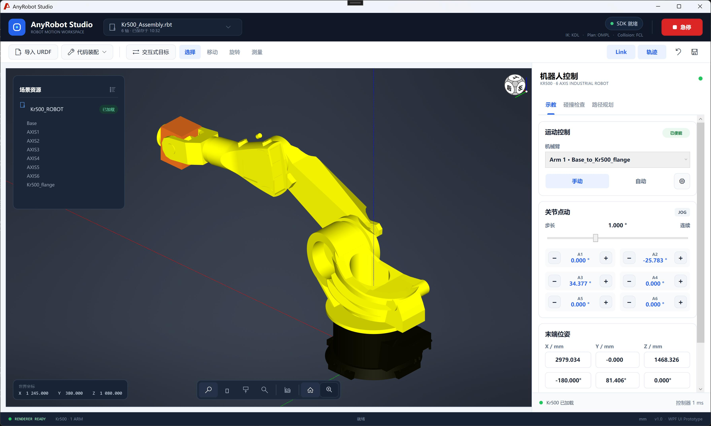
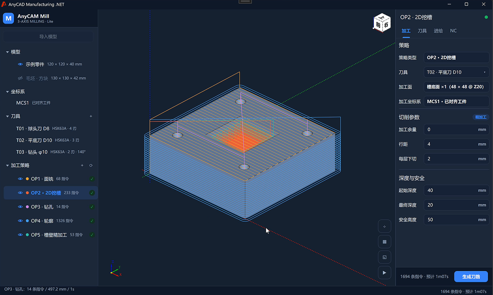
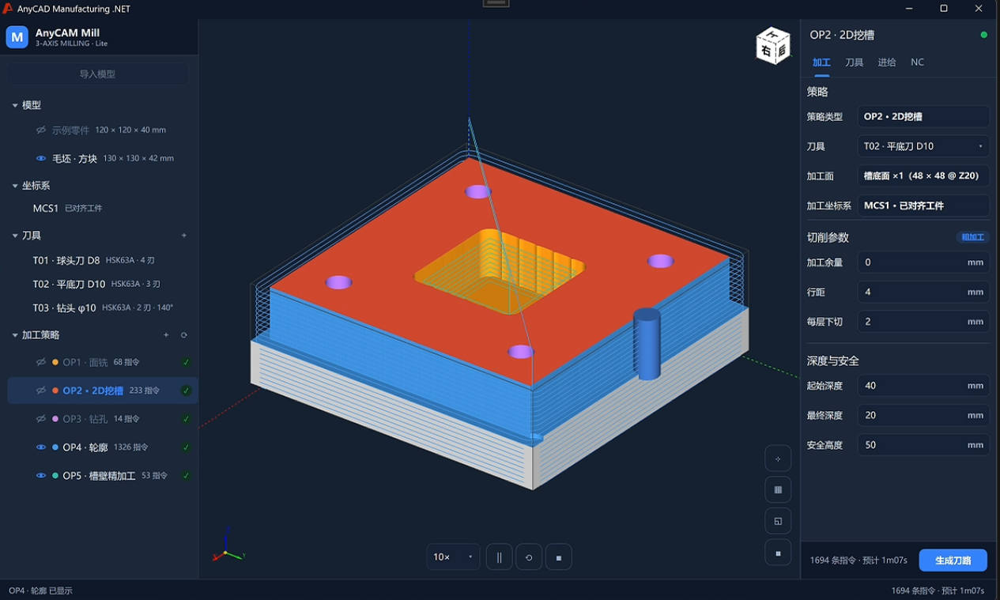

# AnyCAD CAM应用集

## AnyRobot Studio

| 文档 | 用途 |
| --- | --- |
| [RapidRobot 开发手册](docs/RapidRobot-开发手册.md) | 构建、运行、架构、实现细节、验证。 |
| [AnyCAD.Simulate.NET 开发手册](docs/AnyCAD.Simulate.NET-开发手册.md) | 正式包完整功能用法与公开 API 索引。 |

## AnyCAM Mill

三轴加工切削应用，包括路径生成、切削仿真、NC代码生成等

| 文档 | 用途 |
| --- | --- |
| [AnyCAM代码](Mill/) | 完整代码。 |